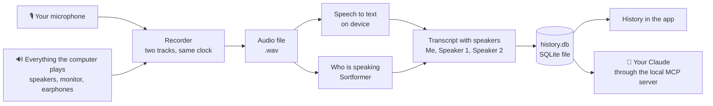
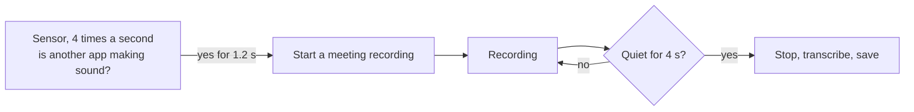
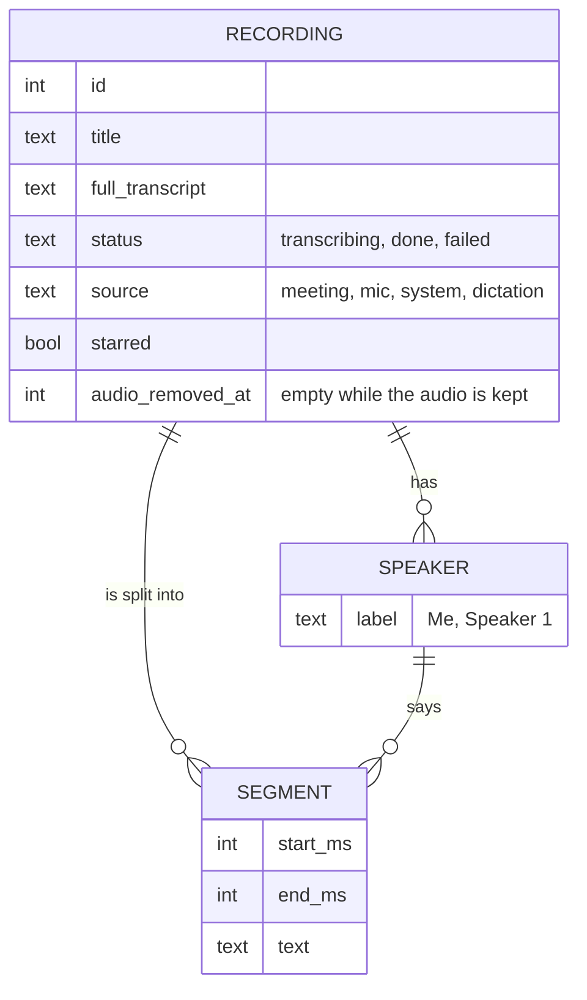
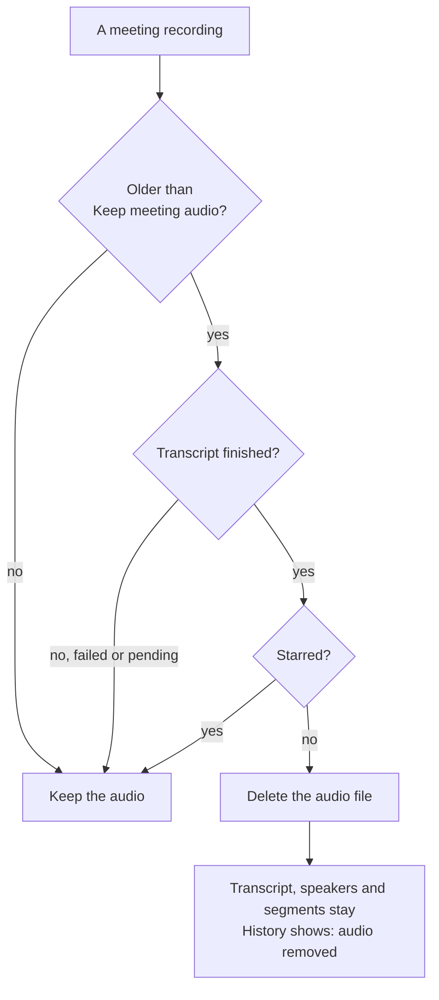
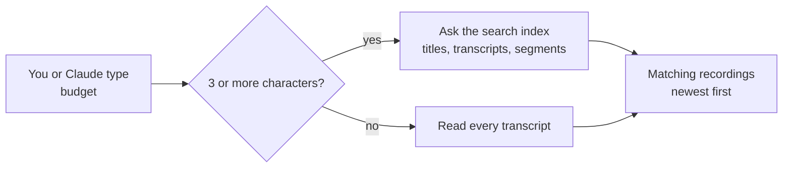

# How Plaudy works

A plain-language tour in five pictures: how a call is recorded, how recording
starts by itself, what gets stored, what gets deleted, and how search finds
things. Everything happens on your computer; nothing is uploaded.

## 1. Recording a call

Plaudy records two things at once: **your microphone** (you) and **what your
computer plays** (the other people on the call). On Windows it listens to
*every* output device at the same time, so it does not matter whether the call
plays through the speakers, the monitor or Bluetooth earphones, or whether you
switch device halfway through.

| | Windows | macOS |
|---|---|---|
| Other side of the call | WASAPI loopback on every active output device, rescanned every 2 s | CoreAudio process tap |
| Speaker labels | Sortformer (up to 4 voices) | Sortformer or sherpa-onnx |

## 2. Starting by itself (optional auto-capture)

If you turn on **Auto-capture**, a small sensor checks four times a second
whether another app is *actually making sound*. A paused video or an idle
Teams window does not count; Plaudy's own playback does not count.

## 3. What is stored

One SQLite file holds everything. Each recording is one row; its transcript
is split into timed segments, each linked to a speaker. Two search indexes
are kept in sync automatically.

The audio itself is a `.wav` file next to the database, about 115 MB per hour.
The text is a few kilobytes per hour.

## 4. What gets deleted, and what never does

Transcripts of meetings are **never** deleted automatically. Only the large
audio file is, after the period you choose under **Sessions → Keep meeting
audio** (7 days by default, or 30, 90, forever). Audio is kept, whatever its
age, while it is still needed.

Short dictations keep their own, older rule (keep the last N, or N days).

## 5. Searching

Search uses a full-text index, so it stays instant after years of meetings
(1 000 meeting-hours: from 17-30 seconds without the index to under 0.1
seconds with it). It matches any part of a word, ignoring upper or lower
case, exactly like before.

The index updates itself whenever a transcript is saved, changed or deleted.

---

More detail: [docs/CODEBASE.md](CODEBASE.md) for the code layout,
[docs/adlc/BASELINE-WINDOWS.md](adlc/BASELINE-WINDOWS.md) for the Windows port,
and the stories in [`plan/stories/`](../plan/stories/) (WIN-CAP-003,
WIN-SENSE-001, DATA-001, DATA-002) for the reasoning behind each piece.
